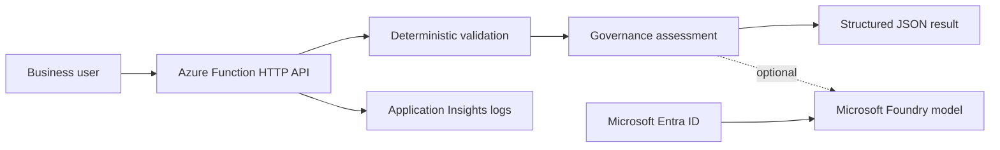

# Architecture and operating model

## Design decisions

- Validation and the final readiness decision are deterministic and testable.
- A model may summarize the decision but cannot change the recommendation.
- The HTTP trigger uses Function-level authorization by default.
- The optional model call uses `DefaultAzureCredential`, allowing managed identity in Azure.
- Logs contain a correlation identifier and decision status, not request content.
- Production deployment should add API Management, rate limiting, private networking and organization-specific policy controls.

## Delivery lifecycle

1. Business and IT define the use case, owner and measurable goal.
2. The API validates required governance metadata.
3. Deterministic rules select prototype, limited pilot, controlled PoC or blocked.
4. Optional AI creates a short stakeholder summary from the structured result.
5. Application Insights receives operational events for monitoring and diagnosis.
6. Human owners decide whether the use case may continue.
